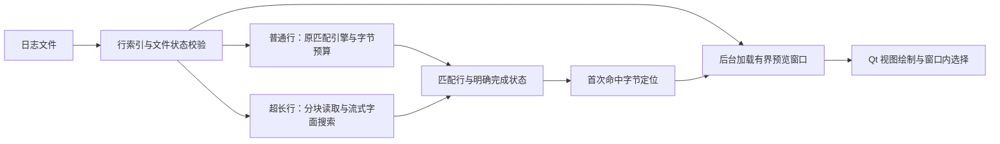

# klogg-longline

2026-10-18 生命周期复查：定位并修复索引任务退出死锁，以及[窗口关闭后的排队回调](docs/ui-callback-lifecycle-fix.md)，见[索引任务生命周期报告](docs/worker-lifecycle-fix.md)。

2026-10-18 后续修复：首版合并后的 CI 暴露了 Windows 文件监控取消时的释放后写入；独立复现、修补与回归边界见 [IOCP 生命周期修复](docs/windows-iocp-fix.md)。下列 2026-10-17 性能数据仍归属历史源码。

基于 [klogg](https://github.com/variar/klogg) 的大文件与超长行可靠性改进：64 位索引边界修复、完整字面搜索、按字节控制的搜索批次，以及异步有界预览。

保留 C++17、Qt Widgets、CMake/Ninja 和 oneTBB。源码位于 `upstream/klogg`，以固定上游提交的源码快照导入，未导入上游 Git 历史。

## 要解决的问题

日志文件大与单行内容长是两种不同压力：按行数分批不能限制一条超长行的分配量；只限制绘制区域，也不能避免后台先读入整行。这个项目围绕真实 klogg 的索引、搜索和视图路径进行改进。

| 独立同类反例 | 固定基线表现 | 本项目改进 |
| --- | --- | --- |
| 压缩索引块内跨度达到 4 GiB | 索引异常退出 | 普通跨度保留压缩快路径，宽跨度使用 64 位存储 |
| 16 MiB 单行开启换行 | 严重内存膨胀后分配失败 | 共享文本存储，只保留可见换行项，异步加载窗口 |
| 搜索 5 GiB 无换行文件 | 按行分批无法控制单行空间 | 跨块延续匹配状态，完整扫描并记录首次命中字节位置 |

这里的反例和测量来自本机 Windows 环境，原始失败与候选结果分别保存。

## 已实现

- 压缩索引在块内相对跨度超过 4 GiB 时使用 64 位存储，并修复空范围、移动和弹出后重用。
- 超长行使用流式 UTF-8 字面搜索，跨块保持匹配状态，返回命中行及首次命中字节位置。
- 普通搜索在读取前规划整行字节批次，使用随数据生命周期释放的预算租约。
- 每行最多读取 16 KiB 预览窗口，后台加载、显示字节范围，支持跳转到搜索命中和前后窗口。
- 明确区分完整、取消、部分、失败和源文件变化；隔离旧任务结果，清理预览和搜索生命周期。

## 验证范围

本机 Windows x64、MSVC 19.44、Qt 6.7.3、Qt 正则后端。已完成基线与候选构建、真实 5 GiB 文件索引及末尾命中核验、基础搜索/预览回归和索引组件 ASan 检查。完整验收明细、性能数据与已知限制见 [验证报告](docs/validation-report.md)；当前进度见 [项目状态](docs/STATUS.md)。

最终候选通过 42 个原生测试用例和 33 项 Python 测试；固定普通日志 5 对测量的总耗时中位数变化约 +0.05%。5 GiB 搜索取消反馈约 17.6 ms，原生 Windows 预览最大心跳间隔约 270 ms。这些是本机固定样例结果。

新增长行搜索支持非空、区分大小写、无预过滤的 UTF-8 字面串。超长行正则、布尔、反向匹配及不支持的编码会明确拒绝。整条超长行复制、快速查找和旧式导出也不会冒充完整操作；预览窗口不是完整行。

128 MiB 是活跃搜索数据通路的预算，**不是进程 RSS 上限**。长行命中结果上限为 65,536 行，超过时返回 `partial`。普通路径保留原有结果集合；索引、累计结果和正则引擎内部空间另计。Linux、macOS、Hyperscan/VectorScan 尚未验证。

## 构建与运行

完整准备步骤和可复制的 PowerShell 命令见 [构建及验证手册](docs/build-and-run.md)。环境准备后：

```powershell
.\tools\build.ps1 -Variant candidate -Jobs 4
```

构建输出在忽略的 `.local/build-candidate/`。大文件样例、依赖、构建产物与原始采样留在 `.local/`；精简复核记录通过 `tools/export_evidence.py` 导出到 `evidence/`。

## 实现结构



生产改动集中在 `upstream/klogg/src/logdata` 和 `upstream/klogg/src/ui`；`tests/native` 调用真实应用组件，`tools/fixtures.py` 提供独立参考程序。可审查补丁在 [patches/](patches/long-line-reliability.patch)，逐文件哈希随补丁记录保存。

## 持续集成

[GitHub Actions](https://github.com/Die4U23/klogg-longline/actions) 的结果与本机验收分开记录。PR 合并要求当前提交的检查全部通过：Python 工具与来源完整性检查，以及 Windows 干净环境下的 Qt 原生构建和回归测试。

托管 CI 不重跑本机 5 GiB 性能对照，也不把 Python 在其他系统上运行解释为 Linux/macOS 原生应用已验证。历史大文件、取消和资源测量以 [2026-10-17 验收报告](docs/validation-report.md) 为准。

## 文档

- [PRD 与 AC01—AC12](klogg-long-line-reliability-prd.md)
- [技术选型报告](klogg-technology-selection-report.md)
- [实现契约与资源边界](docs/implementation-contract.md)
- [测量方法](docs/validation-method.md)
- [源码及依赖来源](UPSTREAM.json)

## 许可与来源

基线为 [`25c7de6`](https://github.com/variar/klogg/tree/25c7de6d8f6da2ce6a00882e5af70b4f331af4c5)。项目遵循 GPL-3.0-or-later，保留上游版权、[LICENSE](LICENSE) 与 [NOTICE](NOTICE)。源码归属信息与本仓库提交历史分别管理。
