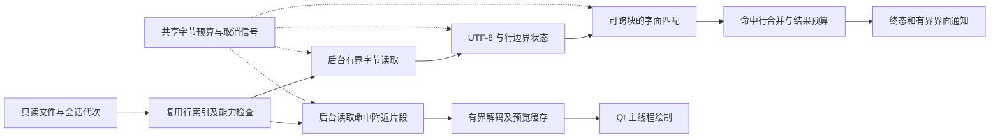

# klogg 大文件与超长行可靠性改进：技术选型报告

日期：2026-10-15  
依据：同目录《klogg 大文件与超长行处理改进 PRD》v0.1  
原始报告状态（2026-10-15）：技术路线建议与源码审查完成，当时尚未构建或复现。

**实施更新（2026-10-17）**：已按本报告选定的 C++17 / Qt Widgets / CMake / oneTBB 路线完成源码导入和 Windows 构建。同类故障已在固定基线复现，实际采用了 64 位宽跨度索引、跨块 KMP、RAII 字节预算与后台有界预览。当前验证结论以 [验证报告](docs/validation-report.md) 为准。以下章节保留选型时的证据和取舍，涉及“待验证”“目前”的表述均指原始报告日期。

## 1. 选型结论

建议采用 **C++17 + Qt Widgets + CMake/Ninja + 上游 oneTBB 调度体系**，在固定版本的 klogg 上完成最小必要改造。首版以 **Windows x64、本地静态文件、UTF-8、区分大小写的字面搜索**作为主要验证范围。

核心方案是：复用原有行索引和紧凑命中集合，必要时补充按字节范围读取、统一在途字节预算、可跨块延续的字面匹配，以及后台读取的有界预览。普通路径继续保留上游能力。新路径优先采用顺序流式匹配，先获得正确性和资源边界，再决定是否增加并行度。

目前可以确定技术栈与设计约束，但不能确定所有改动都需要实施。M0 必须先在固定环境复现故障并取得热点证据；如果最小修复已满足需求，就不继续扩展架构。如果无法复现原问题或同类可量化问题，交付复现报告与回归建议，停止核心改造。

| 决策 | 选择 | 冻结程度 |
| --- | --- | --- |
| 开发语言、界面 | C++17、既有 Qt Widgets 界面 | 确定，不升级语言标准或重写 GUI |
| 基线 | PRD 指定提交 `25c7de6d8f6da2ce6a00882e5af70b4f331af4c5` | 本报告分析基线；M0 检查后续相关修复后再冻结实施基线 |
| 首版平台 | Windows x64；Linux 用于补充检测 | 选定验证优先级；未宣称已支持或验证 |
| Qt | 以该基线 CI 的 Qt 6.7.3、qt5compat、MSVC x64 套件为复现起点 | 历史基线复现选择，不代表推荐最新发布环境 |
| 编译与构建 | MSVC、CMake 3.29.2、Ninja 1.12.0 | CMake/Ninja 本机已查到；MSVC、Qt 可用性及具体编译器版本待 M0 验证 |
| 依赖 | 沿用 CPM 与基线依赖声明，记录实际解析版本和 SHA | 不引入另一套包管理体系 |
| 读取 | 后台 `QFile` 二进制范围读取，64 位文件偏移 | 选定方向；仅在现有接口无法满足预算时增加接口 |
| 搜索 | 先审计现有匹配器；需新增长行字面路径时首选流式 KMP | 条件选定；不得为了使用 KMP 重写已满足要求的路径 |
| 调度与内存 | 复用 oneTBB/既有 worker；RAII 管理字节预算 | 选定约束；节点拓扑依据复现决定 |
| 索引与结果 | 原有 `LinePositionArray`、`roaring::Roaring64Map` | 复用，另行核算内存与检查数值边界 |
| 预览 | 有界片段、异步读取、有限缓存、代次校验 | 选定方向；具体阈值为待实测初值 |
| 验证 | Catch2 2.13.8、Qt Test、CTest；Python 生成器与独立参考程序 | 复用现有测试体系，脚本仅用于验证 |

## 2. 证据与判断边界

本地工作目录目前只有 PRD，没有 klogg 源码检出或可运行构建。本报告通过固定提交的上游源码、构建文件、CI 配置和官方文档进行选型，不把静态阅读当作复现结果。

公开报告 #803 来自 macOS，#773 来自 Windows；两者均报告旧版 22.06.0.1289、Qt 6.2.4。它们提供测试线索，不能证明分析基线仍有同样缺陷。Windows 上通过同类测试也不能证明 macOS 原问题已修复。[问题 #803](https://github.com/variar/klogg/issues/803)、[问题 #773](https://github.com/variar/klogg/issues/773)。

对固定提交的审查得到以下事实。

| 已核实事实 | 对选型的影响 | 尚不能得出的结论 |
| --- | --- | --- |
| 根 CMake 指定 C++17，可选择 Qt6/Qt5；Windows x64 CI 使用 Qt 6.7.3 | 延续 C++17 与 Qt6，复现时使用明确版本 | 不代表该组合已在本机成功构建 |
| 搜索使用 oneTBB flow graph，读取批次由行数控制，limiter 上限为匹配线程数乘 3 | 限任务数不能代替限字节数；应补足实际存活数据的预算 | 不能直接认定该机制是两个 issue 的根因 |
| `getLinesRaw` 按行区间计算总字节数，再调整缓冲大小并读取 | 一条超长行即可使一个批次变大；仅减少每批行数不够 | 不能据此给出实测峰值内存 |
| UTF-8 兼容且无预过滤时已有直接字节视图；其他分支可能同时存在原始、UTF-16 和 UTF-8 数据 | 新路径应复用已有优化，预算应覆盖同时存活的副本 | 不应声称所有 UTF-8 搜索都发生了转码 |
| 展示路径取得完整行，并进行展开、快速查找、换行等处理 | 预览必须在取整行之前限界；仅后台搜索分块不够 | 不等于已经定位 GUI 停顿的具体函数 |
| 文件偏移是 `int64_t`，行号是 `uint64_t`；压缩索引内部仍存在 32 位相对偏移 | 复用强类型，检查整个转换链及压缩块跨度 | 不能用“顶层是 64 位”替代跨 4 GiB 测试 |
| 搜索结果已使用 `Roaring64Map` | 复用紧凑结构，不新增所有命中位置数组 | 压缩结构并不保证任何负载都占用很小内存 |

证据：[构建配置][build]、[CI 配置][ci]、[搜索实现][search]、[读取与转码实现][read]、[展示实现][view]、[数值类型][types]、[压缩索引][index]、[结果定义][results]。

特别需要测试压缩索引中相对偏移转为 `uint32_t` 的前置条件。绝对偏移跨越 4 GiB，与同一压缩块覆盖跨度超过 4 GiB，是两类不同测试。该处目前列为数值边界风险，不直接宣布已发现可复现缺陷。

## 3. 技术栈与依赖取舍

### 3.1 保留原生 C++/Qt 体系

本项目的主要工作位于已有读取、索引、搜索与绘制链路中。保留 C++17 可以直接修复对象生命周期、缓冲区所有权与取消行为，也便于将补丁与上游对照。Qt Widgets 已提供成熟的窗口与交互基础，首版不引入 QML、Electron、WebView、Rust FFI 或 Python 业务运行时。

MSVC 作为 Windows 首选，原因是与分析基线 Windows CI 的工具链方向一致。不会因为当前 PATH 中有其他编译工具就改用 MinGW；Qt、编译器、依赖库必须采用相容的架构与 ABI 组合。当前 PATH 未找到 `cl` 和 `qtpaths6`，这仅表示未发现可直接调用的命令，不证明软件未安装。

Qt 6.7.3 仅作为固定基线复现起点。若后续需要公开发布、升级依赖或迁移 Qt，单独评估并重新建立对照，避免将依赖变化与本次补丁混在一起。Qt5 保持源码兼容与可获得环境下的回归；本轮不把 32 位构建纳入 5 GiB 正式验收。

### 3.2 保留已有依赖，不按“最新版”重新组装

| 组件 | 固定提交中的声明 | 本轮用途与处理 |
| --- | --- | --- |
| oneTBB | `variar/oneTBB`，SHA `c9be1ac2930f02dea523003ed801b4489f3e6b6e` | 保留已有任务调度，不另建全局线程池 |
| Hyperscan | `variar/hyperscan`，SHA `0931a40e0cf1d7f92189bc546c3491ed5c113f8b` | Windows x64 默认匹配后端；保留既有语义 |
| Vectorscan | SHA `d29730e1cb9daaa66bda63426cdce83505d2c809` | 基线非 Windows 默认选项；按平台原配置验证 |
| simdutf | 5.6.2 | 复用已有编码能力；不将 SIMD 优化作为本轮目标 |
| CRoaring | 4.2.1 | 保留命中行集合 |
| streamvbyte | 1.0.0 | 保留压缩行索引；重点验证内部相对偏移范围 |
| Catch2 | 2.13.8 | 扩展既有测试，不迁移 Catch2 大版本 |
| mimalloc | 2.1.7 的依赖声明 | 实际启用状态按构建记录；不主动更换分配器 |

以上来自[基线依赖配置][deps]，是声明值，不是本机已经解析或链接的版本。M0 应记录 CPM 是否选用了本地包、依赖最终提交、Qt 套件、编译器版本、CPU 指令集、分配器和所有 CMake 开关。保存构建命令、`CMakeCache.txt` 与依赖清单，基线和候选使用相同配置。

调试诊断采用带符号的优化构建；正式吞吐对照使用一致的优化级别、LTO 和 CPU 选项。构建文档中的旧示例以实际 CMake 定义为准，例如测试开关应核实为 `KLOGG_BUILD_TESTS`，而不能直接照搬旧示例。

## 4. 数据路径方案

### 4.1 按需改造的处理链路

图中表示职责边界，不要求新增对应数量的模块、线程或文件。现有接口已满足要求的部分直接复用。

### 4.2 读取：QFile 有界读取优先

新增接口如有必要，应表达“从指定文件字节偏移读取最多若干字节”，不通过“先取得完整行，再切片”实现。文件以只读二进制模式打开，避免文本换行转换破坏原始偏移。`seek`、读取返回值及偏移加法必须检查，缓冲分配前先完成范围与预算验证。

首版优先单个顺序读取者配合既有后台调度。预览可使用独立句柄，或复用经过验证的串行访问封装；不在多个线程无保护地交错操作同一 `QFile` 的 `seek/read`。Qt 文档标注的可重入不能理解为任意共享实例都线程安全。[QFileDevice 文档][qfile]。

暂不引入 mmap、IOCP、平台专用异步 I/O 或零拷贝框架。它们增加文件变化、映射生命周期和跨平台处理成本，当前尚无证据证明它们是达成 PRD 的必要条件。同步文件调用放在后台可以保护 GUI，但不能据此承诺任何磁盘或网络文件系统上都能在固定时间内中断系统调用。

### 4.3 匹配：条件选择流式 KMP

如果需要新增可跨块字面匹配器，选择 KMP 作为首版实现：保存模式前缀表和当前匹配状态，不依赖整行常驻，也不需要保留随模式变长的重叠输入窗口。其扫描成本为 O(N + M)，模式状态为 O(M)；这是算法性质，不是项目吞吐成绩。

需要在实现中冻结以下契约：

- 新路径支持非空、大小写敏感的字面串；拒绝包含逻辑换行的模式，维持按行搜索。空串及其他模式继续走已定义的能力检查，不能静默改写含义。
- 对有效 UTF-8、无大小写折叠、无 Unicode 规范化的字面匹配，可扫描 UTF-8 字节序列。模式先编码并校验；数据在同一遍扫描中保持 UTF-8 校验状态。不会为了搜索而把整条长行转换成 `QString`。
- 遇到无效 UTF-8，新路径明确失败并标明原因，已产生的结果不标为完整；这是新路径的显式契约。旧路径保留其既有解码行为。若要求二者完全一致，再评估有界解码后的匹配，不直接假设等价。
- 换行处按既有行定义结束匹配状态；CRLF 跨块时保留边界状态。先用基线确认 CR、LF、BOM、空文件、尾随换行、末行无换行的实际行为，再冻结参考程序规则。
- 一行多个命中仅产生一个行结果；进入下一行前仍须推进边界、编码校验及取消检查。详细命中位置按需重新扫描，不能保存全部位置。
- 字节位置、逻辑行号和 Qt 的 UTF-16 列位置分别表示。窗口中的列位置不冒充整行字符索引，不能为转换一个远端位置在 GUI 线程扫描整条长行。
- 模式长度初始上限拟定为编码后 1 MiB，作为新路径公开限制；模式预处理也需检查取消。测试应主动使用更小的块，使合法模式长于块，证明实现不依赖“模式短于块”。

正常文件继续保留现有搜索路径，以减少性能和语义变化。若索引发现目标范围存在超长行，首版优先对整个选定范围启用一次顺序字面扫描，减少同一任务中新旧路径交错的状态复杂度。只有性能对照证明有必要，才考虑按完整行分区并行；同一长行的状态不能随意分配给互不协调的多个 worker。

不选择简单固定重叠块作为通用正则方案，也不增加新的正则引擎。既有 Hyperscan/Qt 等后端继续承担已验证的能力，流式字面路径仅覆盖明确声明的子集。

### 4.4 预过滤与模式能力检查

源码中的 prefilter 会改变参与搜索的文本，因此“直接扫描原始字节”不能无条件替代原搜索。首版新路径要求未启用此类文本变换。普通日志保留原有行为；超长行叠加 prefilter、大小写不敏感或未经验证的正则时，运行前明确提示该组合暂不支持，不能自动忽略设置或回到可能无限占用资源的路径。

能力判断依赖已有索引提供的行长度等信息。若还不能判断，先完成可取消的索引或检查阶段，不能先启动不可控匹配器再补警告。该限制应在 UI 中说明，并作为 AC10 的回归内容。

## 5. 资源、结果和预览边界

### 5.1 初始参数

以下为工程试验初值，均未通过实测冻结。

| 参数 | 初值建议 | 用途 |
| --- | --- | --- |
| 单次读取块 | 2 MiB，比较 1/2/4 MiB | 控制分配、吞吐和取消粒度 |
| 在途数据预算 | 128 MiB，所有活动会话共享 | 避免多个标签页各自扩张 128 MiB |
| 预览保留额度 | 从上述预算中预留 8 MiB | 搜索饱和时仍允许必要预览工作 |
| 进入长行保护的阈值 | 原始行长 1 MiB | 与必验最小长行样例对齐；最终按 GUI 采样调整 |
| 单次预览 | 最多 64 KiB 原始片段 | 解码和绘制只处理有限文本 |
| 预览缓存 | 最多 8 MiB，属于上述预览额度 | 将原始、解码后和缓存文本同时计入 |
| 单搜索结果预算 | 64 MiB，另设总结果预算建议 128 MiB | 避免高命中密度与多个会话累积 |
| CPU 内循环取消检查 | 每处理最多 64 KiB 输入检查一次 | 不等待完整长行结束；匹配预处理等长循环同样检查 |
| GUI 进度合并 | 约 100 ms 刷新一次，只保留最新待投递进度 | 避免工作线程生成无界事件队列 |

128 MiB 是特定数据对象的逻辑预算，不是操作系统 RSS 限额；“预览额度”和“预览缓存”也不能重复加算成额外空间。阈值与默认值最后由 M0/M1 的样例与交互数据冻结。

### 5.2 预算实现选择

采用可移动、不可复制的 RAII 预算凭证，将预算与实际缓冲所有权绑定。分配前预留，生产者持有、排队、处理、等待合并期间持续占用，最后一个所有者释放后归还；异常、拒收、取消和队列清空都走同一释放机制。使用引用共享缓冲时不能重复计数，也不能因消息移出队列就提前释放额度。

预算至少包含原始缓冲容量、同时存活的转码容量、边界与模式状态、匹配临时对象、预览文本，以及相关批次容器容量。按 `capacity` 或已知分配上界核算，而不是只统计当前字符串长度。共享视图与深复制必须区分。

防止预算死锁：不能让所有批次占满原始缓冲后，再一起等待无剩余额度的转码分配。可在批次接纳时预留已知最坏处理空间；超出单批可容纳范围时减小块或明确失败。预算等待必须响应取消，不能占住所有 TBB 执行线程等待必须由同一线程池释放的资源。

合并端的临时结果计入数据通路预算；长期保留的索引、结果集合和 GUI 绘图资源单列。报告至少分别展示数据通路峰值、索引占用、结果占用，以及操作系统内存指标；Windows 记录 Working Set 与 Private Bytes，Linux 记录对应 RSS 等指标，不跨平台混称同一口径。

### 5.3 结果与索引

复用 `Roaring64Map`，不替换成每个命中一个对象的列表。预算检查必须考虑容器扩容、合并副本与临时空间；序列化大小只能作为估计线索，不能充当实际驻留内存的严格上限。如现有库无法给出可靠分配计量，采用保守上界和有界合并批次，并明确剩余估计误差。

达到结果预算时，停止新增工作并返回 `partial`，显示已扫描范围和停止原因。并行路径中只能报告已确认完成的区间，不能把最大返回偏移当成连续完成进度。完整导出若实施，应作为独立流式操作，重新扫描完整选择范围；不能直接把一个 partial 集合导出后标为完整。

行索引沿用现有结构，但必须单独记录容量和扩张过程。若压缩块的相对偏移范围不能覆盖测试输入，在原有索引内修复分块或溢出表示，不建立第二套全文件索引。索引资源不足时停止加载并明确失败，不能让不完整索引看起来像完整文件。

### 5.4 预览与高亮

后台按可见范围或命中附近读取有限片段，截取 UTF-8 边界时可额外读取少量边界字节，并计入预算。GUI 仅接收有上限的文本和定位信息，显示“当前片段范围 / 行总字节数 / 已截取”。搜索范围始终独立于预览范围。

片段高亮需要处理横跨片段边界的命中；可通过可取消的行内扫描定位，不能因为片段本身不包含完整模式就显示“该行没有命中”。超长模式超过预览上限时允许分段展示，同时标明整个命中范围。

长行保护应覆盖 tab 展开、自动换行、快速查找、高亮、复制以及选择文本获取，不能在预览之后又由某个辅助功能调用整行接口。保护模式下按片段换行和高亮；普通日志保留原行为。复制超出允许范围时显示范围和限制，不能静默截断后声称完整复制。

Qt GUI 对象继续只在主线程访问，后台通过队列连接传递结果；不能用反复调用 `processEvents()` 掩盖主线程中的整行工作。[Qt 线程与 QObject 文档][threads]。

## 6. 取消、文件变化与兼容

每个任务携带文件身份、文件会话代次及操作代次。后台合并共享状态前和 GUI 接收结果时都检查代次，文件切换、重新搜索或重新索引会使旧任务结果失效。仅在界面过滤迟到消息还不够，旧任务也不能修改新会话的索引和结果集合。

复用已有原子中断标志，按任务生命周期管理，避免新任务清除仍被旧任务观察的同一个取消状态。取消必须覆盖预算等待、读取前后、匹配与编码内循环、结果合并及预览任务；退出后回收预算和句柄。GUI 发出取消后不执行阻塞式等待。

统一终态采用 PRD 的五类：`complete`、`cancelled`、`partial`、`failed`、`source_changed`。通过一次性终态提交防止重复完成通知：完整扫描且完成一致性检查后才能提交 complete；取消与正常完成的竞争以原子终态提交顺序确定，记录原因和已处理范围。

静态文件范围内，记录打开时的文件身份、长度和修改信息，结合已有 filewatch、读取异常、阶段性和结束检查识别替换、截断与增长。短读仅处理实际返回字节，不能使用缓冲尾部未读区域；错误或相对快照长度的异常按原因进入 failed 或 source_changed。

路径名相同不等于文件相同。需要时用薄的平台适配层补足文件身份获取，但不重写整个 I/O 层。仅检查长度和时间戳无法保证识别所有同长度原地修改，因此首版不宣称提供并发写入下的文件快照。确定性验收对受控静态样例记录运行前后 SHA-256；已有 follow 功能另做兼容回归，不套用新路径的静态文件保证。

## 7. 测试、观测与验收方案

选择已有 Catch2 + Qt Test + CTest 体系，避免同时维护 GoogleTest 等第二套框架。新增流式核心尽量可脱离 QWidget 测试；Python 标准库脚本负责确定性生成样例、SHA-256 与独立参考核对，Python 不进入应用运行依赖。[现有单元测试配置][tests]。

参考程序不能复用生产 KMP。小样例可整段使用独立的字节查找与行定位；大样例采用有界窗口加模式长度减一的重叠、按绝对起点去重的参考实现，内存独立核算。核对命中行集合和需要验证的字节位置，不只比较条数。参考程序也必须检查跨块、跨换行和末行规则。

| 验证层 | 重点 | 对应验收 |
| --- | --- | --- |
| 纯核心 | 跨块、重叠模式、模式长于块、UTF-8 分片、CRLF、末行、预算与取消状态 | AC04、AC05、AC07、AC08 |
| 文件集成 | 1/16/64 MiB 长行、全文件单行、跨 4 GiB 偏移、真实写入的 5 GiB 文件 | AC03、AC06、AC09 |
| 兼容 | 普通日志、其他编码、预过滤、正则、follow、复制与恢复行为 | AC02、AC10 |
| GUI | 搜索、预览、滚动、切换文件、取消与关闭，真实窗口事件循环 | AC08、AC11 |
| 对照复现 | 原报告可得环境或独立同类反例，保存失败与候选结果 | AC01、AC12 |

5 GiB 实体样例必须真实写入并校验长度与内容；稀疏文件可补充偏移边界单测，但不能替代实体样例的 I/O、内存和交互验收。压缩索引跨度测试还需要刻意构造同一索引块跨度超出 32 位的输入。

Windows 首选带符号采样配合 WPR/WPA 观察 CPU、线程等待和 I/O；需要分配来源时另采堆分配或工具支持的分配事件。应用内记录读取、校验/转码、匹配、合并、GUI 处理耗时，及预算当前值和峰值。WPR 是基于 ETW 的记录工具，具体采样配置随 M0 固定，不能认为默认记录自动包含所有内存证据。[Microsoft WPR 文档][wpr]。

GUI 使用 `QTimer` 配合单调时钟记录事件处理间隔，并结合调用栈判断是否为应用同步工作导致停顿。保存原始时间序列、最大间隔和超阈值事件，不只给平均值。取消记录请求时刻、终态时刻和最终资源释放时刻，区分及时提示与后台真正结束。

正式性能对照按相同文件、线程数、优化参数、磁盘与缓存条件至少重复三轮。暖缓存和冷缓存分开记录；无法控制系统缓存时标为未控制，不声称冷缓存结果。记录中位吞吐、峰值内存、预算峰值、心跳和取消延迟。候选普通负载中位吞吐下降超过 10% 时，必须解释并选择修复、限定长行路径或撤回。

取消 1 秒内反馈、应用同步工作导致的 GUI 停顿不超过 500 ms，沿用 PRD 作为待冻结验收目标；本报告没有任何实测达标结论。ASan/UBSan 使用适用编译器和构建配置单独运行，竞态疑点再安排 TSan 或专项并发测试；不将检测器运行结果纳入正式性能比较。Linux/WSL 可补充核心检测，不能代替 Windows 原生 GUI 与文件行为测试。

## 8. 备选方案与不采用理由

| 方案 | 本轮决策 | 重新评估的条件 |
| --- | --- | --- |
| 只降低搜索线程数或每批行数 | 可作为诊断变量，不能作为最终资源保证 | 实测证明问题仅来自可界定并发，且长行分配另有可靠上限 |
| 全文件 mmap | 暂不采用，优先显式范围读取与错误处理 | 读取已证实成为主瓶颈，并完成文件变化与映射异常设计 |
| 全部搜索改成 KMP | 不采用，保留普通路径和既有模式 | 对照证明确有维护收益且普通负载不过度回退 |
| 新增 RE2/其他正则引擎 | 不采用，避免新增语义差异与依赖 | 后续独立 PRD 明确要求，并有兼容与取消方案 |
| 改用 Rust 或重写线程框架 | 不采用，跨语言与调度迁移扩大范围 | 独立项目目标变化，已有最小补丁确实无法满足 |
| SQLite/持久化索引 | 不采用，复用内存索引及紧凑结果 | 明确提出跨运行复用索引等新需求 |
| 更换分配器、手写 SIMD | 暂不作为优化手段 | 已保证正确性和预算，采样仍显示对应热点 |
| 从零重做日志查看器 | 不采用，无法服务本 PRD 的上游修复目标 | 应另立项目，不能作为本任务的实现方式 |

## 9. 实施顺序与退出条件

| 阶段 | 主要工作 | 决策出口 |
| --- | --- | --- |
| M0：建立可复现基线 | 检出固定提交，检查后续相关修复和重复补丁，完成构建锁定、样例、阶段指标和热点采样 | 复现原问题或量化同类问题才进入修改；否则交复现报告 |
| M1：最小修复 | 修复已证实的边界、取消、分配或显示问题，补对应回归 | 已满足全部需求则进入最终对照，不人为增加模块 |
| M2：按需完善数据通路 | 字节范围接口、预算与所有权、流式匹配、编码和数值边界 | 正确性、资源回收、完整性终态都有证据 |
| M3：按需完善交互 | 有界预览、复制与高亮限制、能力检查、迟到结果隔离 | 真实 GUI 响应与普通模式兼容通过 |
| M4：交付证据 | 基线/候选重复实验，逐项填写 AC01—AC12，保留全部失败与限制 | 交付本地补丁、构建、生成器、回归与对照报告 |

报告不预估确定开发天数：当前没有构建和复现证据，可能只是局部修复，也可能同时涉及读取与 GUI。M0 完成后，按实际失败路径冻结实现范围和工作量，不能用计划替代根因分析。

开始编码前还需冻结：具体 MSVC/Qt 可用套件、实施提交、无效 UTF-8 和行结束契约、预算记账方式、长行阈值、能力检查覆盖范围，以及是否能取得 macOS 复现环境。这些是执行中的验证项，不要求为了常规实现选择逐项等待人工确认。

交付继续保留上游作者、NOTICE 与 GPL-3.0-or-later 标识，并清楚列出本项目新增修改和验证；许可证来源见[上游 NOTICE][notice]。本轮交付为选型报告，不包括源码实现、发布或联系维护者。

## 10. 资料来源

上游代码链接均固定到本报告分析提交，可追溯具体版本；Qt 与 Microsoft 官方文档链接用于 API 和工具说明，可能随站点更新。报告中的参数、路由及预算设计是本项目建议，不是上游已实现能力。

- [根构建配置][build]、[第三方依赖][deps]、[Windows 等平台 CI][ci]。
- [读取与编码处理][read]、[索引 worker][worker]、[搜索 worker][search]、[GUI 展示][view]。
- [数值类型][types]、[压缩索引实现][index]、[结果集合定义][results]、[单元测试配置][tests]。
- [Qt QFileDevice][qfile]、[Qt 线程与 QObject][threads]、[Windows Performance Recorder][wpr]。
- [上游 NOTICE][notice]；需求来源见第 2 节 issue 链接。

[build]: https://github.com/variar/klogg/blob/25c7de6d8f6da2ce6a00882e5af70b4f331af4c5/CMakeLists.txt
[deps]: https://github.com/variar/klogg/blob/25c7de6d8f6da2ce6a00882e5af70b4f331af4c5/3rdparty/CMakeLists.txt
[ci]: https://github.com/variar/klogg/blob/25c7de6d8f6da2ce6a00882e5af70b4f331af4c5/.github/workflows/ci-build.yml
[read]: https://github.com/variar/klogg/blob/25c7de6d8f6da2ce6a00882e5af70b4f331af4c5/src/logdata/src/logdata.cpp
[worker]: https://github.com/variar/klogg/blob/25c7de6d8f6da2ce6a00882e5af70b4f331af4c5/src/logdata/src/logdataworker.cpp
[search]: https://github.com/variar/klogg/blob/25c7de6d8f6da2ce6a00882e5af70b4f331af4c5/src/logdata/src/logfiltereddataworker.cpp
[view]: https://github.com/variar/klogg/blob/25c7de6d8f6da2ce6a00882e5af70b4f331af4c5/src/ui/src/abstractlogview.cpp
[types]: https://github.com/variar/klogg/blob/25c7de6d8f6da2ce6a00882e5af70b4f331af4c5/src/logdata/include/linetypes.h
[index]: https://github.com/variar/klogg/blob/25c7de6d8f6da2ce6a00882e5af70b4f331af4c5/src/logdata/src/compressedlinestorage.cpp
[results]: https://github.com/variar/klogg/blob/25c7de6d8f6da2ce6a00882e5af70b4f331af4c5/src/logdata/include/logfiltereddataworker.h
[tests]: https://github.com/variar/klogg/blob/25c7de6d8f6da2ce6a00882e5af70b4f331af4c5/tests/unit/CMakeLists.txt
[notice]: https://github.com/variar/klogg/blob/25c7de6d8f6da2ce6a00882e5af70b4f331af4c5/NOTICE
[qfile]: https://doc.qt.io/qt-6/qfiledevice.html
[threads]: https://doc.qt.io/qt-6/threads-qobject.html
[wpr]: https://learn.microsoft.com/en-us/windows-hardware/test/wpt/windows-performance-recorder
